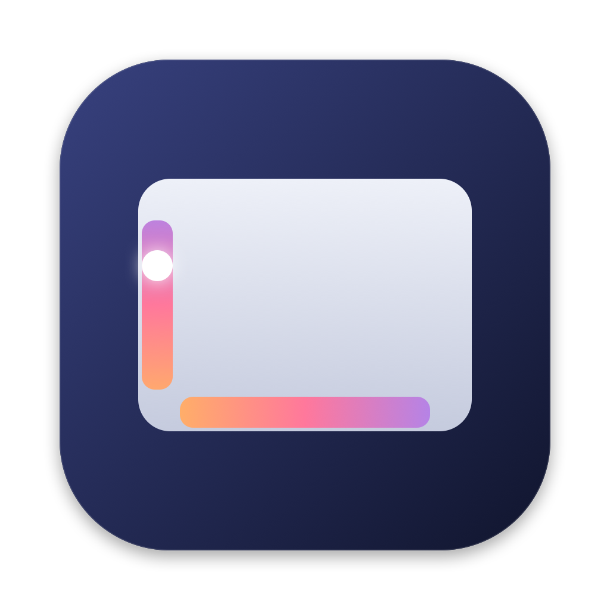

<h1 align="center">Bevel</h1>

The edges of your trackpad and Magic Mouse, put to work. 
Brightness of the screen you're looking at, volume, windows, music and more, without reaching for a key.

<a href="../../releases/latest"><b>Download the latest release</b></a> · <a href="https://tomserowka.github.io/bevel/">Website</a> · free · macOS 13+ · no network code, no tracking

---

## What it does

Slide a finger along an edge, or double-tap a corner, of the built-in trackpad, a Magic Trackpad or a Magic Mouse:

| Where | Gesture | Default |
| --- | --- | --- |
| Left edge | slide | Brightness of the screen **under the pointer**. Keep going down to dim below the screen's minimum. Two fingers: warmth. |
| Right edge | slide | Volume: of Spotify while it plays, on whichever device it plays on; otherwise of the Mac. Hold your finger still to pick the sound output, slide to choose, lift to switch. |
| Top edge | swipe | Move the front window to the next screen. |
| Bottom edge | flick or slide | Flick for the next track (right) / previous track (left); slide slowly to skip forward or back within the song in Spotify or Music. |
| Top-left corner | double-tap | Dark mode |
| Top-right corner | double-tap | Mute |
| Bottom-left corner | double-tap | Lock screen |
| Bottom-right corner | double-tap | Play / pause (or run any Shortcut) |
| Magic Mouse front edge | slide | Volume |
| Magic Mouse left side | slide | Brightness. Two fingers: warmth. |
| Magic Mouse right side, back edge | slide | Nothing until you pick an action |
| Magic Mouse corners (front and back) | double-tap | Nothing until you pick an action |
| Magic Mouse, anywhere | tap | Off until you turn on **Tap to click**: one finger clicks, two fingers right-click |

Every zone can be reassigned in **Settings**, which lists each zone with its own action picker under a picture of the device that also shows your fingers live.

Screens:

- **Every screen, separately.** Built-in and Apple displays use the system's own brightness; most other monitors are driven over DDC/CI, the same way their buttons do it. Screens that support neither are dimmed in software.
- **Below the minimum.** Past the darkest backlight setting Bevel darkens the picture itself, for late nights.
- **Warmth per screen**, unlike Night Shift, which changes them all.
- **All screens together**, if you turn it on: one slide moves every screen.
- **External screens follow the room light**, if you turn it on, using the Mac's light sensor. Change a screen's brightness any way you like and it keeps following from there.
- **Corner actions for screens:** turn the screens off, or switch a monitor to another input (say, a second computer).

Windows and apps:

- **Corner actions for windows:** maximise or restore the front window, or tile it to that corner's quarter of the screen (the Magic Mouse's front corners tile to halves, its back corners to the bottom quarters).
- **App switcher on an edge:** hold a finger still to pick from your recent apps, slide to choose, lift to switch. On the Magic Mouse, turn on **Hold to pick** first.
- **Per-app setups:** give an app its own actions, say Seek on the bottom edge in your video player.

Sound and feel:

- **Microphone mute** as a corner action, for calls.
- **Seek** as an edge action: slide to skip back or forward in Spotify or Music while they play, even behind other apps, or else in the front app's player.
- **Keyboard backlight** as an edge action.
- Haptic ticks while you slide, with a firmer one at 50 % and at the ends.

Look:

- **The edge lights up.** While you slide a level, the matching edge of the screen glows and fills to it, in the icon's amber-to-violet.
- **Out of the notch.** On a MacBook with a notch, the on-screen display grows out of it. Both can be turned off in Settings.

The pointer stays put while you slide an edge, stray clicks from tap-to-click are held back in corners, and a single tap in a corner still clicks as usual.

**Draw on screen** (Settings › Draw on Screen): pick a shortcut, then hold it to point things out on screen, in a call or a recording. A toolbar at the top of the screen (or keys 1 to 7) picks pen, arrow, ellipse, rectangle, numbers, highlighter or spotlight, plus the line size and colour. Shift-, Option- and Command-drag are shortcuts for arrow, ellipse and rectangle, and a click places numbered markers 1, 2, 3… Z undoes, C clears, [ and ] change the size, and W turns the screen into a whiteboard (again for a blackboard). N switches to glowing neon marks. Switch on fading ink and marks vanish by themselves a few seconds later. Let go and it's gone. Prefer press-to-start? Switch it to press once to draw, again to clear.

## Install

1. Download `Bevel-<version>.dmg` from [Releases](../../releases/latest).
2. Open it and drag **Bevel** into **Applications**.
3. Open Bevel. Bevel isn't notarised yet, so the first time macOS may refuse: open **System Settings › Privacy & Security**, scroll down and click **Open Anyway**.
4. Follow the welcome window and allow **Accessibility**. Bevel works without it, but then the pointer can drift while you slide and windows can't be moved.

Bevel lives in the menu bar. Open it again from Applications to bring up Settings.

Requires macOS 13 or later. Universal: Apple Silicon and Intel.

### Permissions

| Permission | Why | Without it |
| --- | --- | --- |
| Accessibility | Keep the pointer still, hold tap-to-click clicks in corners, move windows, the drawing shortcut | Edges still work; the pointer is warped back instead, windows can't move, the drawing shortcut does nothing |
| Automation (System Events) | The Dark mode corner | Asked the first time you use it |
| Automation (Spotify) | Volume slides while Spotify plays | Asked the first time; without it the slide changes the Mac's volume |

Bevel has no network code, collects nothing and stores only its settings (in `~/Library/Preferences/io.github.tomserowka.bevel.plist`).

## Feedback

Found a bug or want a gesture? [Open an issue](../../issues/new/choose). If Bevel earns a place in your menu bar, a ⭐ helps others find it.

## License

Bevel is free to download and use. The source code is not public. © 2026 Tom Serowka. All rights reserved.
